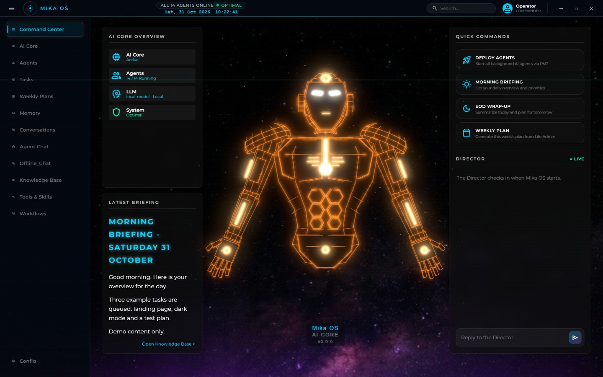
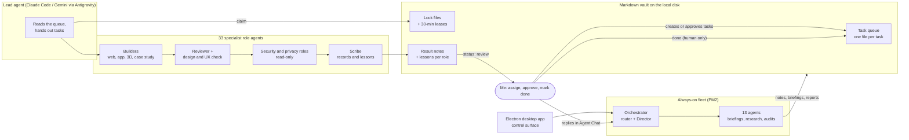

# CHAMP OS

A multi-agent system: a lead agent orchestrates 33 specialist role agents (Claude Code, Gemini via Antigravity) through a markdown task queue with locks, human approval gates and review/security gates; a separate always-on fleet of 13 agents runs the day-to-day.



*The desktop app's command centre, with demo content. The app was first called Mika OS, which is why the screenshot still shows that name. More: [agent fleet page](docs/agent-fleet-demo.jpg) (demo data).*

## The problem, and the key design decision

**Problem.** I wanted one place to hand work to AI agents and keep my notes, with every task tracked, reviewed and approved by me, instead of a pile of separate dashboards and chats.

**Key design decision: plain markdown files are the shared memory and the task queue.** Every task is a markdown file with a small header (status, assignee, what it may touch, how it will be tested). Agents claim a task with an atomic lock file and a 30-minute lease, so two agents can never work on the same task. People and agents read and write the same files, so there is no database to migrate and I can inspect everything in a normal notes app. Agents can only move a task to *review*; only I can mark it *done*.

## Architecture



More diagrams exported from the portfolio page: [always-on fleet](docs/architecture.svg), [data flow](docs/data-flow.svg) and [Director approval workflow](docs/approval-workflow.svg).

## How it works

1. **A markdown task queue with locks.** Each task file names its assignee, the files it may touch, the test that proves it is done and what it depends on. An agent claims a task by creating its lock file with an exclusive create: if the file already exists, someone else has it. The claim writes a 30-minute lease into the task, the owner renews it with a heartbeat, and a stale lease can be taken back only by the orchestrator, only after a 10-minute grace period. Locks are moved to a *released* folder, never deleted, so the history stays. The helpers are in [`agents/shared/obsidian.js`](agents/shared/obsidian.js).
2. **A lead agent and 33 role agents.** The lead reads the queue and hands each task through a fixed pipeline: an explorer finds what is relevant, a builder role does the work, then a reviewer, a design and UX check for anything people will see, the matching security or privacy role, and a scribe that records the result. A failed review goes back to the builder, not to me. Every role reads its own lessons file before starting and adds 1-3 lessons when it is done.
3. **Human approval gates.** Agents stop at *review* for anything that cannot be undone: publishing, sending a message, pushing code, deleting files, spending money, submitting forms or changing security settings. My approval comes from my own terminal or a signed line in Agent Chat, never from another agent's message.
4. **The always-on fleet.** Under PM2, an orchestrator classifies each request and routes it to one of 12 agents. Its Director loop checks agent states every 30 seconds, can pause or resume an agent, and posts check-ins. It may run a job only after I reply and agree, and only if the job is one of 8 fixed actions in the code. Scheduled agents write morning briefings, plans, research and nightly security reports into the vault. One optional service can run local models.
5. **A desktop control surface.** An Electron app shows the fleet, the vault, Agent Chat and a Three.js graph of the notes. It never runs agent logic itself; it talks to the fleet and reads the vault.

## Security model

- **Least privilege by role.** Security, privacy and audit roles are read-only. The builder agent only writes files into its own folder and never runs or installs what it writes.
- **Humans hold the irreversible actions.** Anything that publishes, sends, pushes, deletes, spends or changes security settings stops for my approval. Agents can propose work but cannot mark it done.
- **Approval is never inferred from chat.** Another agent's "approved" counts for nothing. The Director's model reading my reply is only a soft check; plain code then allows only a short fixed list of actions, none of which deletes files, installs packages or pushes code.
- **One writer per file.** Tasks whose allowed files overlap never run at the same time, and atomic locks stop two agents claiming the same task.
- **Local by default.** The agent services are reachable only from the same machine, and a nightly agent checks that. Data lives as plain files on the local disk, with no database and no sync service. Outside calls are limited to the model APIs, the package registry and web fonts, and a setting keeps all model calls on the local model.
- **Secrets stay out of the code.** API keys are kept in git-ignored environment files, checked nightly, and the desktop app reads its key in the trusted main process, never in the page.
- **A hardened desktop boundary.** The app's page is isolated from Node.js and reaches the system only through a small set of functions the preload bridge exposes.

## Testing and results

- **Task-queue helpers:** 18 tests in [`agents/shared/test/obsidian-tasks.test.js`](agents/shared/test/obsidian-tasks.test.js), run with Node's built-in test runner (`node --test`). They cover two simultaneous claims (exactly one wins), lease and heartbeat rules, owner-only finishing, lock history, stale takeover timing (including leases written by hand with a time-zone offset) and Windows paths with spaces. Every test uses a throw-away temporary vault. **Result: 18 of 18 pass** (17 Nov 2026).
- **Offline chat logic:** 13 tests in `app/test/offline-lib.test.js`.
- The fleet watches itself: nightly exposure and dependency audits write their reports into the vault.
- The queue held 117 task files on 17 Nov 2026; finished work is written up in a result note per task, with what was run and what was seen.

## Setup

```bash
git clone https://github.com/mikachamp/champ-os.git
cd champ-os

# run the queue-helper tests (18 tests)
cd agents && npm install && node --test shared/test/obsidian-tasks.test.js

# start the desktop app
cd ../app && npm install && npm start

# offline chat logic tests (13 tests)
node --test test/offline-lib.test.js
```

Copy `agents/.env.example` to `agents/.env` and set your own vault path and keys. Local models are optional. To start the agent fleet, run `npx pm2 start ecosystem.config.cjs` inside `agents/`. For test runs, `MIKAOS_NO_AGENTS=1` skips the fleet and `MIKAOS_VAULT` overrides the vault path.

| Folder | What it is |
|---|---|
| `app/` | The Electron desktop app (frameless window, tray, chat, graph views) |
| `agents/` | Orchestrator, PM2 config, the agent services, shared libraries (`shared/obsidian.js`, `shared/llm.js`) |
| `agents/shared/subagent-roles.json` | The role registry: what each role does, its reading list, test standard and limits |
| `.claude/agents/` | One agent file per role, generated from the registry |
| `AGENT_OPERATING_RULES.md` | The rules every agent follows |
| `docs/` | Diagrams, demo screenshots and the [build story](docs/BUILD-STORY.md) |

## Status

Working locally on my Windows PC. Next steps: apply the security hardening that is in review, then replace the always-on processes with one orchestrator and short-lived role agents that claim a task, write their result and stop.
